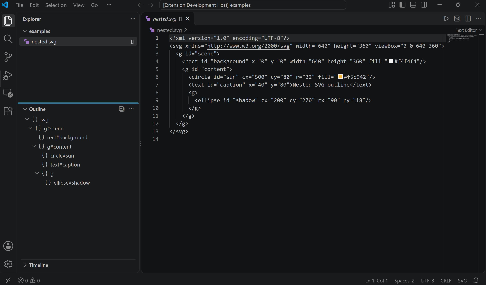
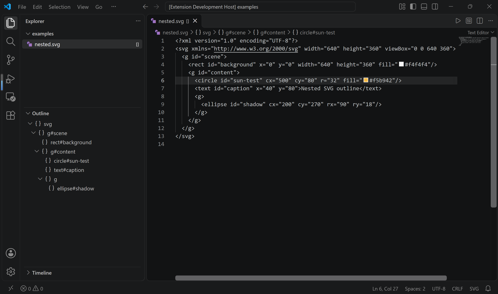
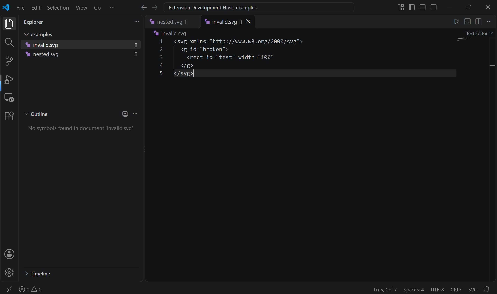

# Phase 2 测试与验证材料索引

本文件是测试证据导航，不替代测试代码。可复现的自动化验证由仓库中的 Vitest 测试和 GitHub Actions 完成；VS Code UI 行为由 Extension Development Host 人工验收并以真实运行截图留档。

## 1. 自动化测试位置

| 验收主题 | 测试文件 | 覆盖内容 |
|---|---|---|
| 架构依赖约束 | `src/__arch__/dependency-rules.test.ts` | 内核/上层依赖方向和结构约束 |
| dir 命令 | `src/cli/DirCommand.test.ts` | 测试替身、目录优先、文件排序、隐藏项、空目录、读取失败、真实临时目录适配器 |
| stats 命令 | `src/cli/StatsCommand.test.ts` | 空文档、DFS 叶子计数、容器计数 |
| TreeDecorator | `src/cli/TreeDecorator.test.ts` | decorator 输出与树渲染 |
| PluginHost | `src/plugins/PluginHost.test.ts` | manifest 不匹配、重复注册、暂存失败不残留 |
| PluginLoader | `src/plugins/PluginLoader.test.ts` | 模块缺失、无 default export、模块求值/依赖失败、配置错误、激活失败回滚 |
| A/B 装配一致性 | `src/plugins/assembly.test.ts` | 两种装配的贡献集合与命令会话输出一致 |
| Box Composite | `src/plugins/box/box.test.ts` | box 结构、属性、组合不变量和相关行为 |
| CLI 端到端 | `src/cli/e2e-transcript.test.ts` | 命令会话与输出回归 |
| VS Code 扩展 | `vscode-extension/src/extension.ts`、`svgOutline.ts` | 扩展入口、Explorer decoration、Outline parser；构建由 TypeScript 编译验证 |

## 2. 本地复现命令

在仓库根目录运行：

```powershell
npm ci
npm run build
npm test
npm run metrics
```

在 VS Code 扩展目录运行：

```powershell
cd vscode-extension
npm install
npm run compile
```

随后在 VS Code 中打开 `vscode-extension/` 并按 F5，启动 Extension Development Host。

## 3. CI 记录

Phase 2 validation workflow（包含 CLI 构建、测试、metrics，以及 VS Code 扩展安装与 TypeScript 编译）：

https://github.com/yukiwizov/svg-editor/actions/runs/45380900830

该 run 对应提交 `b1c19f1`（截图归档提交），状态为 **completed / success**；CLI 与 VS Code Extension 两个 jobs 均成功。Explorer/Outline 的交互行为另由下列人工验收截图记录。

## 4. VS Code 人工验收截图

以下截图均来自真实的 VS Code Extension Development Host，文件原图保存在 `docs/images/`。

### 4.1 Explorer SVG 文件装饰

SVG 文件显示 `[]` 装饰，普通文件和目录不显示该标记。



### 4.2 Outline 嵌套结构与源码定位

Outline 展示 SVG 的嵌套节点；选择节点可定位到编辑器中的对应源码。


### 4.3 编辑后实时更新

修改元素的 `id` 后，Outline 随文档内容变化同步更新。



### 4.4 无效 XML 安全处理

面对不完整或无效 XML，Outline 安全显示无符号/空结果，扩展宿主保持运行，不因解析失败崩溃。


